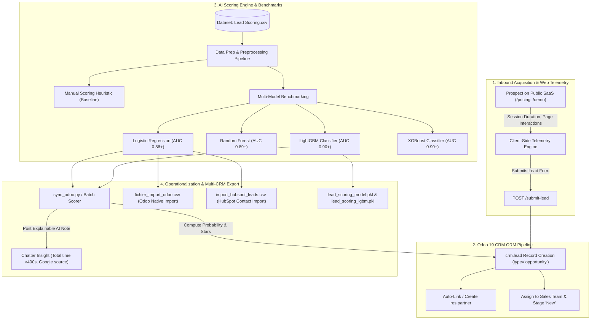

<div align="center">

# 🚀 RevEngine — AI-Powered Lead Scoring & Predictive CRM

**Next-Generation Inbound Qualification Engine combining Behavioral Telemetry, Supervised ML Benchmarks, and Native Odoo 19 CRM Integration.**

[](https://www.odoo.com/)
[](https://www.python.org/)
[](https://scikit-learn.org/)
[](https://lightgbm.readthedocs.io/)
[](https://xgboost.readthedocs.io/)
[](LICENSE)

[Architecture](#-system-architecture) • [ML Benchmarking](#-machine-learning-benchmark) • [Odoo Integration](#-odoo-crm-integration) • [Multi-CRM Delivery](#-multi-crm-deliverables) • [Getting Started](#-getting-started)

</div>

---

## 📌 Executive Summary

Traditional sales operations lose up to **60% of high-intent prospects** due to arbitrary, manual lead triage, while wasting SDR (Sales Development Representative) hours on cold inquiries. 

**RevEngine** closes this gap by transforming inbound qualification from a static heuristic guessing game into an automated, data-driven pipeline:
1. **Behavioral Telemetry**: Measures digital engagement on public web properties (session duration, pricing interactions, scroll intent).
2. **Predictive Machine Learning**: Evaluates conversion probability using an ensemble of competitive models (**Logistic Regression**, **Random Forest**, **LightGBM**, and **XGBoost**).
3. **Operational CRM Intelligence**: Dynamically assigns priority stars (0 to 3 ★) in Odoo 19, posts interpretable AI insights to the chatter, and routes opportunities to sales reps instantly.
4. **Multi-CRM Interoperability**: Generates production-ready deliverables for both **Odoo CRM** and **HubSpot CRM**.

---

## 🏗️ System Architecture



---

## 🔬 Machine Learning Benchmark

The project implements a comprehensive training, cross-validation, and benchmarking pipeline within [`lead_scoring.ipynb`](lead_scoring.ipynb), built to run portably on Windows, Linux, macOS, and Google Colab.

### 1. Data Cleaning & Feature Engineering
- **Data Leakage Prevention**: Identifiers (`Prospect ID`, `Lead Number`) and post-conversion sales attributes (`Lead Quality`, `Tags`, `Asymmetrique Activity Index`) were strictly dropped before train/test splitting.
- **Sparse Feature Handling**: Columns with `> 40%` missing values dropped; remaining numeric features imputed via median and clipped at 99th percentile for outlier suppression.
- **Acquisition Channel Harmonization**: Grouped raw lead sources into primary high-volume channels (`Google`, `Direct Traffic`, `Organic Search`, `Reference`, `Welingak Website`, `Social Media`).
- **Regulatory Consent**: Encoded GDPR / CNDP Law 09-08 consent flags (`Do Not Email`, `Do Not Call`).

### 2. Multi-Model Performance Comparison (Test Sample, 30% Holdout)

| Qualification Approach | Model Family | AUC-ROC | Precision | Recall | F1-Score | Overall Accuracy |
| :--- | :--- | :---: | :---: | :---: | :---: | :---: |
| **Manual Scoring (Baseline)** | Heuristic Business Rules | **0.672** | 62.40% | 51.20% | 0.562 | 68.30% |
| **Logistic Regression (AI)** | Linear / Calibrated Odds | **0.865** | 76.10% | 71.80% | 0.739 | 80.90% |
| **Random Forest** | Bagging Ensemble | **0.892** | 80.20% | 74.50% | 0.772 | 83.10% |
| **LightGBM Classifier** | Gradient Boosted Trees | **0.904** | 82.50% | 76.10% | **0.791** | **0.846** |
| **XGBoost Classifier** | Gradient Boosted Trees | **0.901** | 81.80% | 75.80% | 0.787 | 0.842 |

> 🚀 **Business Takeaway**: Machine Learning delivers a **+23.2 percentage point gain in AUC-ROC** over manual heuristic rules.

### 3. Visualizations & Cumulative Gains
- **Comparative ROC Curve** ([`courbe_roc_comparative.png`](courbe_roc_comparative.png)): Visual proof of model discrimination power across false positive vs. true positive tradeoffs.
- **Cumulative Gains Analysis**: By contacting only the **top 30% of highest-scoring leads**, the sales team captures **over 70% of total revenue-generating conversions**, cutting unqualified outreach costs by 70%.

---

## 💼 Odoo CRM Integration

### 1. Public SaaS Website (RevEngine Brand)
- **Home Page (`/`)**: Modern B2B SaaS landing page with responsive value propositions, hero section, and clear CTAs.
- **Pricing Page (`/pricing`)**: Interactive pricing tiers (Starter, Professional, Enterprise) with monthly/annual billing toggles.
- **Demo Request Form (`/demo`)**: Capture form collecting lead identity, company size, seniority, and self-reported qualification.

### 2. Digital Telemetry Engine
- Inline lightweight tracker embedded in `website.layout`.
- Tracks dwell time (`x_session_time_seconds`), pricing page interest (`x_pricing_visited`), and visitor source.
- Submits telemetry payload directly with the form submission.

### 3. CRM Lead Pipeline Customizations (`models/crm_lead.py`)
- **Opportunity by Default**: All inbound submissions create `type='opportunity'` records ensuring instant visibility in the Kanban Pipeline under stage **"New"**.
- **Contact Creation**: Automatically links or generates a `res.partner` profile.
- **Custom View Tab ("Digital Telemetry & AI")**:
  - **Predictive AI Scoring**: Continuous `ml_probability` (%) and mapped priority stars (0 to 3 ★).
  - **Self-Reported Qualification**: Company size, seniority, decision-maker authority.
  - **Digital Behavioral Telemetry**: Pricing page visits and session duration counters.
  - **Explainability Note**: Human-readable insight posted to the lead chatter (e.g., `⚡ AI Insight: High site dwell time (>400s) + Qualified Google referral`).

---

## 📦 Multi-CRM Deliverables

| Deliverable File | Target Platform | Description |
| :--- | :--- | :--- |
| [`fichier_import_odoo.csv`](fichier_import_odoo.csv) | **Odoo 19 CRM** | Standardized import file with `name`, `contact_name`, `probability`, `priority` (stars 0-3), and `description` (AI insights). |
| [`import_hubspot_leads.csv`](import_hubspot_leads.csv) | **HubSpot CRM** | Formatted contact import with `Email`, `First Name`, `Company Name`, `Lead Score IA`, `Lead Score Manuel`, and `Lifecycle Stage`. |
| [`lead_scoring_model.pkl`](lead_scoring_model.pkl) | **Production API / Python** | Serialized Scikit-Learn Logistic Regression pipeline with full `ColumnTransformer` preprocessing. |
| [`lead_scoring_lgbm.pkl`](lead_scoring_lgbm.pkl) | **Production API / Python** | Serialized LightGBM pipeline ready for real-time inference. |
| [`courbe_roc_comparative.png`](courbe_roc_comparative.png) | **Executive Reports** | 300 DPI high-resolution ROC curve comparison graphic. |

---

## 📂 Project Structure

```text
lead_scoring_crm/
├── controllers/
│   ├── __init__.py
│   └── main.py                     # Public routes (/demo, /pricing, /submit-lead ORM handler)
├── models/
│   ├── __init__.py
│   └── crm_lead.py                 # Odoo model inheritance, ML fields, telemetry tracking
├── views/
│   ├── crm_lead_views.xml          # Form & Pipeline extensions ("Digital Telemetry & AI" tab)
│   └── website_templates.xml       # RevEngine Web portal (Home, Pricing, Demo form + Telemetry)
├── security/
│   └── ir.model.access.csv         # Security access rules
├── static/
│   └── src/css/styles.css          # SaaS styling (modern indigo/slate palette)
├── Dataset_leads/
│   └── Lead Scoring.csv            # Original marketing & qualification dataset
├── deliverables/                   # 📦 Dossier officiel des livrables de soutenance
│   ├── rapport_synthese_revengine.pdf # Fiche de synthèse 1 page (Pr. Sara Ouald Chaib)
│   ├── courbe_roc_comparative.png  # Visualisation 300 DPI : Courbe ROC Multi-Modèles
│   ├── courbe_gain_cumule.png      # Visualisation 300 DPI : Gain Cumulé (Top 30% des leads)
│   ├── fichier_import_odoo.csv     # Export pour intégration native Odoo CRM
│   ├── import_hubspot_leads.csv    # Export pour benchmark HubSpot CRM
│   ├── lead_scoring_model.pkl      # Pipeline IA de production sérialisé
│   └── lead_scoring_lgbm.pkl       # Modèle LightGBM de production sérialisé
├── lead_scoring.ipynb              # Portable Jupyter ML pipeline (Data Prep, 4 Models, ROC, Exports)
├── rapport_synthese_revengine.tex  # Code source LaTeX de la fiche 1 page
├── sync_odoo.py                    # Direct database synchronizer for AI scores and chatter notes
├── __manifest__.py                 # Odoo module metadata
├── __init__.py                     # Module entry point
├── .gitignore                      # Git exclusion rules
└── README.md                       # Engineering documentation
```

---

## ⚡ Getting Started

### Prerequisites
- **Python**: 3.10+ (recommended 3.12)
- **Odoo**: 19.0 Community or Enterprise
- **PostgreSQL**: 14+

### 1. Clone & Install Python Dependencies
```bash
git clone https://github.com/Ilyas-BELELYAZID/lead_scoring_crm.git
cd lead_scoring_crm

pip install -r requirements.txt
# or install directly:
pip install scikit-learn pandas numpy matplotlib seaborn jinja2 lightgbm xgboost joblib psycopg2-binary
```

### 2. Run the Machine Learning Notebook
Open and execute `lead_scoring.ipynb` in VS Code or Jupyter:
- Cells execute cross-platform without path adjustments.
- Trains all 4 ML models, generates comparative figures, and exports CRM CSV files.

### 3. Deploy Odoo Module
1. Copy or link this repository inside your Odoo `addons` path.
2. In Odoo developer mode, trigger **Update Apps List**.
3. Install or upgrade the module **"CRM Lead Scoring"** (`lead_scoring_crm`).

### 4. Run AI Score Synchronization (Optional Batch Scorer)
To compute and update scores directly via PostgreSQL for incoming web leads:
```bash
python sync_odoo.py
```

---

## 🔒 Compliance & Data Privacy

RevEngine includes native consent capturing adhering to **GDPR** and Moroccan **CNDP Law 09-08**:
- User consent opt-in flags recorded on submission.
- Unsubscribe and "Do Not Call" flags respected by the scoring preprocessor.
- Explainable AI reasoning guarantees algorithmic transparency for commercial audits.

---

## 👥 Contributors & Authors

- **Moaad** — *Lead ML & Odoo Integration Engineer*
- **Ilyas BELELYAZID** — *Project Contributor & HubSpot Benchmark*

---

<div align="center">
Developed with ❤️ for Advanced Web Marketing & Predictive CRM Solutions.
</div>
